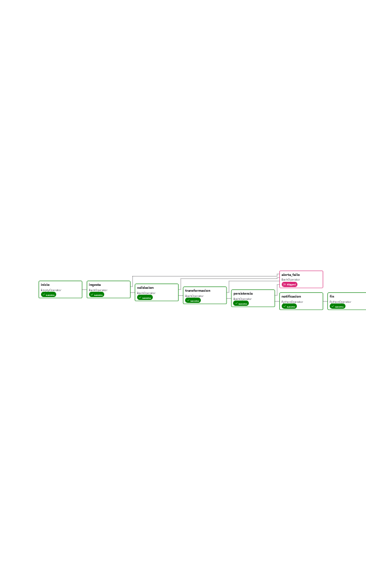
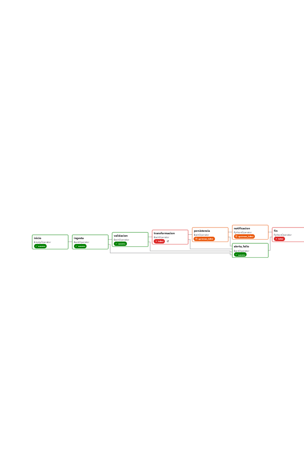
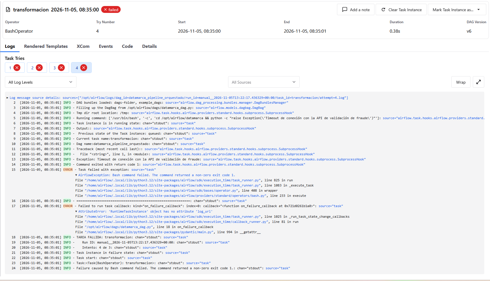

# Orquestación del Pipeline DATAMARCA con Apache Airflow (Unidad 4)

Este módulo implementa la capa de orquestación para el pipeline de datos de DATAMARCA S.A., automatizando el flujo de ingestión, validación, transformación, persistencia y notificación. El entorno está desplegado localmente utilizando Docker y Apache Airflow 3.x.

## 1. Justificación técnica: Airflow vs. AWS Step Functions

*   Arquitectura de Airflow: Requiere gestionar cuatro componentes principales: el Scheduler (decide qué ejecutar), el Executor (gestiona dónde ejecutar), los Workers (ejecutan las tareas) y el Metastore (base de datos PostgreSQL que guarda el estado). Esto implica una carga operativa alta, ya que el equipo debe monitorear los servicios.
*   Arquitectura de Step Functions: Es un servicio serverless de AWS basado en máquinas de estado. Elimina completamente la carga operativa, ya que AWS gestiona el escalado, la disponibilidad y los reintentos.

Decisión para DATAMARCA: Se eligió Apache Airflow por tres razones:
1.  Flexibilidad programática: El equipo escribe el DAG en Python puro. Esto permite ejecutar comandos arbitrarios (`BashOperator`, `PythonOperator`) y ejecutar el pipeline de PySpark sin depender exclusivamente de servicios nativos de AWS.
2.  Portabilidad: La arquitectura de la Unidad 2 se diseñó sobre Google Cloud (GCP). Usar Step Functions ataría el proyecto a AWS.
3.  Control y visibilidad: Aunque la carga operativa es mayor, contar con un entorno local con Docker permite un control total y una observabilidad granular (logs de cada tarea, vista de grafo, métricas) que facilita el desarrollo y las pruebas.

## 2. Arquitectura del DAG

El DAG `datamarca_pipeline_orquestado` representa fielmente el grafo de dependencias del pipeline, con las 5 etapas exigidas:

1.  `inicio`: Nodo de entrada (`EmptyOperator`).
2.  `ingesta`: Ejecuta la ingestión y validación inicial (`src.ingestion`).
3.  `validacion`: Ejecuta el reporte de calidad (`src.data_quality_report`).
4.  `transformacion`: Ejecuta las agregaciones de negocio y persistencia (`src.transformations`).
5.  `persistencia`: Verifica que las tablas Parquet existan en el Data Lake.
6.  `notificacion`: Envía un mensaje de éxito (`PythonOperator`).
7.  `alerta_fallo`: Tarea condicional que solo se ejecuta si alguna tarea anterior falla (`TriggerRule.ONE_FAILED`).
8.  `fin`: Nodo de cierre que se ejecuta siempre (`TriggerRule.ALL_DONE`).



*Figura 1: Vista "Graph" del DAG mostrando las tareas correr exitosamente.*

## 3. Políticas de reintento y Backoff Exponencial

Se configuraron las siguientes políticas en los `default_args`:
*   `retries = 3`
*   `retry_delay = timedelta(minutes=1)`
*   `retry_exponential_backoff = True`
*   `max_retry_delay = timedelta(minutes=10)`

Razonamiento para DATAMARCA:
Como el pipeline depende de fuentes externas (POS, e-commerce, APIs de fraude), los fallos suelen ser transitorios. Se configuran 3 reintentos para dar margen sin caer en bucles infinitos. El primer reintento espera 1 minuto, pero al tener el backoff exponencial activo, los tiempos de espera se duplican (1 min, 2 min, 4 min). Esto es crucial: si el fallo se debe a una sobrecarga del servicio externo, reintentar inmediatamente empeora la situación. El `max_retry_delay` limita la espera a 10 minutos. Además, cada tarea tiene un `execution_timeout` de 30 minutos para evitar que un proceso colgado consuma recursos indefinidamente.

## 4. Manejo de errores y Logging

*   Callbacks: Se definieron funciones `on_failure_callback` y `on_retry_callback` que imprimen en los logs el `task_id`, el número de intento y el estado del DAG.
*   Estado global del DAG (`fin`): Por defecto, en Airflow, un nodo de cierre con `TriggerRule.ALL_DONE` termina en `success` incluso si hubo fallos aguas arriba. Para evitar este "falso positivo", el nodo `fin` se implementó como un `PythonOperator` que consulta el estado del DagRun mediante la nueva API de Airflow 3 (`RuntimeTaskInstance.get_dagrun_state`). Si detecta que el DAG falló, lanza una excepción para que el estado global se marque correctamente como `failed`.
*   Cero reintentos en cierre y alertas: Tanto `fin` como `alerta_fallo` tienen `retries=0`. No tiene sentido reintentar una tarea de notificación o de validación de estado; si el estado es malo, lo será siempre y reintentar solo retrasaría el fallo 7 minutos innecesariamente.

### 4.1 Evidencia de fallo controlado

Para demostrar la resiliencia del DAG, se forzó un fallo en la tarea intermedia `transformacion`, simulando un Timeout ficticio de conexión con la API externa de validación de fraude.

**Resultados observados en la ejecución:**
*   `ingesta` y `validacion` completaron exitosamente (verde).
*   `transformacion` falló con la excepción controlada (rojo).
*   `persistencia` y `notificacion` se cancelaron automáticamente (`upstream_failed`), demostrando que el error no se propaga silenciosamente.
*   `alerta_fallo` se disparó correctamente (verde).
*   `fin` se marcó en rojo (failed), garantizando que la corrida completa refleje el error.
*   El estado global del DagRun se marcó como `failed`.
**Evidencia gráfica del fallo:**



*Figura 2: Vista "Graph" del DAG mostrando la propagación controlada del error (persistencia y notificación en estado `upstream_failed`).*

**Log de la excepción:**


*Figura 3: Traza del log..*

Nota: Las capturas de pantalla de esta evidencia se encuentran en `docs/evidencia_u4/`.

## 5. Cómo ejecutar

1.  Asegúrate de tener Docker Desktop corriendo.
2.  Desde la carpeta `airflow/`, ejecuta:
    ```bash
    docker compose up -d
    ```
3.  Accede a la interfaz web en `http://localhost:8080` (usuario: `airflow`, contraseña: `airflow`).
4.  Activa el DAG `datamarca_pipeline_orquestado` y presiona "Trigger DAG".

### Variables de entorno requeridas
*   `AIRFLOW_UID=50000` (definido en `.env`).
*   `FERNET_KEY` (definido en `.env` para cifrado de credenciales).
*   `AIRFLOW__API_AUTH__JWT_SECRET` (definido en `.env` para la autenticación de la API de Airflow 3.x).

### Supuestos del entorno
*   Los datos de entrada deben estar generados previamente con `python data/generate_sample.py --rows 5000 --seed 134340`.
*   El volumen en `docker-compose.yaml` mapea el código fuente (`src/`) a `/opt/airflow/datamarca` dentro del contenedor para que los `BashOperator` puedan ejecutar el pipeline de la U3.
*   El contenedor se construye usando un `Dockerfile` personalizado que instala Java 17 y PySpark, requeridos por el pipeline.