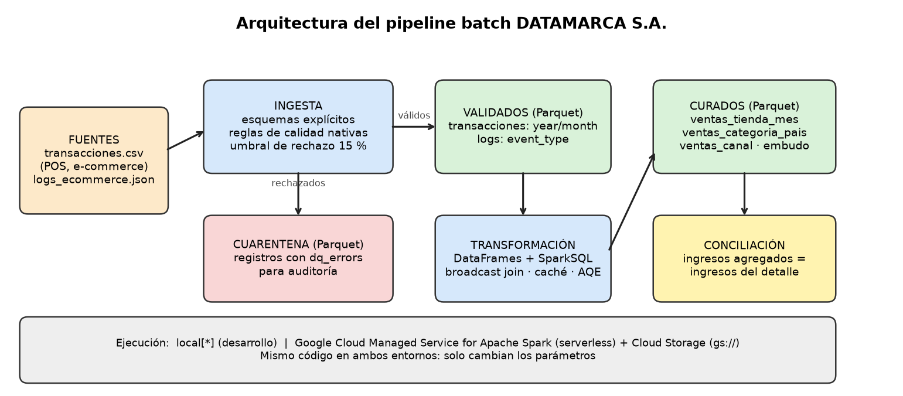

# Informe técnico — Pipeline distribuido DATAMARCA S.A.

Curso: Big Data y Cloud Computing — Universidad de La Sabana · Unidad 3, Actividad 1
Repositorio: https://github.com/anaferrermendez/datamarca-pipeline

## 1. Resumen
Se implementó un pipeline **batch** en Apache Spark (PySpark) que ingesta transacciones CSV y logs JSON de e-commerce,
valida su calidad, los transforma con DataFrames y SparkSQL, y persiste los resultados en Parquet particionado. Se
ejecuta con `python -m src.pipeline` (local) o con `scripts/gcp_ejecutar.sh` (Google Cloud, serverless). Tiene 29 pruebas
unitarias, pruebas de rendimiento y un experimento que mide el efecto de cada optimización.

## 2. Arquitectura

La arquitectura de la Unidad 2 propone una zona de ingesta, almacenamiento distribuido y capas de procesamiento. Esta
implementación la concreta así: fuentes CSV y JSON, ingesta con calidad y cuarentena, capa de datos validados, capa de
datos curados para análisis y conciliación de cifras. Cada capa vive en una carpeta distinta del almacenamiento
(`validated/`, `quarantine/`, `curated/`), lo que permite auditar y reprocesar por separado.

## 3. Datos, esquema y particionamiento
- Fuentes: `transacciones.csv` y `logs_ecommerce.json` (JSON Lines), generadas con semilla fija (`134340`) y errores
  inyectados a propósito para que las reglas tengan qué detectar.
- Esquemas explícitos (sin `inferSchema`); `unit_price` es `Decimal(12,2)` para evitar errores de redondeo en dinero.
- Calidad: reglas como expresiones nativas de Spark (sin UDFs), severidad `error` (cuarentena) o `warning`, y umbral de
  rechazo del 15 % que detiene la corrida.
- Particionamiento: transacciones por `year`/`month` (partition pruning en consultas por periodo); logs por
  `event_type`. No se particiona por tienda para no generar archivos pequeños.

## 4. Modalidad elegida: batch frente a streaming
Se eligió batch porque las fuentes llegan como archivos completos, el negocio necesita reportes (tienda, categoría,
mes) y no reacción en segundos, y varias validaciones (unicidad, logs huérfanos, umbral de rechazo) requieren ver el
lote completo. Un cluster efímero también cuesta menos que uno permanente esperando eventos.
Con el modelo unificado de Apache Beam, batch es el caso acotado de streaming: la lógica de calidad (expresiones de
DataFrame) se reutiliza en Structured Streaming agregando `readStream`, ventanas sobre `timestamp` y `withWatermark`
para datos tardíos. Streaming **no se implementó**, por lo que no se presenta evidencia de ventanas ni de late data.

## 5. Transformaciones y Catalyst
Tablas curadas: `ventas_tienda_mes`, `ventas_categoria_pais`, `ventas_canal` (particionadas por año y mes) y
`embudo_conversion`. Se usan DataFrames y SparkSQL, y ambos pasan por Catalyst. El plan guardado en
`reports/evidencia/02_plan_catalyst_5000.txt` muestra partition pruning, column pruning, `BroadcastHashJoin` y caché.
Spark tiene activado Adaptive Query Execution. Una conciliación compara los ingresos agregados contra el detalle y hace
fallar la corrida si no coinciden.

## 6. Pruebas de rendimiento (entorno local)
Comando: `python -m src.benchmark --rows 5000 50000 250000`. Datos: `reports/evidencia/03_benchmark_rendimiento.*`.
**Entorno:** una máquina Linux con 1 vCPU y 3 GB de RAM en modo `local[*]`. No es un cluster; sirve para ver tendencias.

| Filas | Entrada (MB) | Ingesta (s) | Transformación (s) | Total (s) | Filas/s |
|---:|---:|---:|---:|---:|---:|
| 5.000 | 0,85 | 19,75 | 10,96 | 30,74 | 162,6 |
| 50.000 | 8,45 | 24,66 | 11,50 | 36,20 | 1.381 |
| 250.000 | 42,21 | 36,52 | 14,29 | 50,85 | 4.917 |

Con 10 veces más datos el tiempo crece 1,18 veces, y con 5 veces más crece 1,40 veces: el tiempo está dominado por
costos fijos (arranque de la JVM, planificación y escritura de archivos), no por el volumen. Una corrida completa
con 250.000 filas, con tiempos por etapa, está en `reports/evidencia/05_corrida_completa_250k.log`.

## 7. Experimento de optimización
Comando: `python -m src.experimento_optimizacion --repeticiones 3`. Cada variante se ejecuta con una acción `noop`, tras
un calentamiento, y se reporta la mediana. Datos: 232.464 filas validadas, mismo entorno de 1 vCPU.

| Optimización | Con optimización (s) | Alternativa ingenua (s) | Mejora |
|---|---:|---:|---:|
| Función nativa en lugar de UDF de Python | 0,19 | 0,60 | x3,17 |
| Column pruning (leer solo columnas necesarias) | 0,24 | 0,52 | x2,15 |
| Broadcast join frente a sort-merge join | 1,16 | 1,96 | x1,70 |
| Partition pruning (filtro por `year`/`month`) | 0,19 | 0,32 | x1,68 |
| Caché de las ventas enriquecidas (3 agregaciones) | 4,26 | 3,42 | x0,80 |

Lectura honesta de los resultados:
- Las cuatro primeras optimizaciones reducen el tiempo, y la más fuerte es evitar UDFs, como recomienda la guía.
- **La caché empeoró el tiempo en este entorno** (x0,80). Con datos locales pequeños, en una sola CPU, volver a calcular
  el plan es más barato que materializar la caché. En un cluster con lectura desde Cloud Storage, releer es más caro, y
  la caché puede compensar; esto debe comprobarse con la corrida en la nube antes de afirmarlo.
- En el experimento de *column pruning*, la variante ingenua además calcula una agregación por columna, así que la
  diferencia mezcla lectura y cómputo.
- Las diferencias absolutas son de décimas de segundo; los factores son indicativos, no una garantía en producción.

## 8. Elección del proveedor cloud y estimación de costo
Se comparó Google Cloud (Managed Service for Apache Spark, modo serverless) con AWS EMR Serverless. Se eligió Google
Cloud porque ofrece crédito inicial de USD 300 para cuentas nuevas, no requiere administrar un cluster, trae
integración nativa con `gs://` y cobra por segundo (mínimo un minuto) solo mientras corre el trabajo. EMR Serverless es
una alternativa equivalente en modelo de cobro (USD 0,052624 por vCPU-hora y USD 0,0057785 por GB-hora en us-east-1),
pero sin capa gratuita específica. El detalle está en `docs/despliegue_gcp.md`.

Modelo de costo: `DCU-horas consumidas × tarifa por DCU-hora`. Con una configuración de 12 DCU (un driver y dos executors
de 4 vCPU), cada hora de ejecución cuesta unos USD 0,72 con la tarifa de referencia de USD 0,06 por DCU-hora, que debe
verificarse en la página oficial. El consumo real en DCU lo informa Google Cloud en cada batch, y
`scripts/gcp_resumen.py` calcula el costo exacto de cada corrida.

Estimación local previa (modelo de nodos, supuesto sin verificar): 3 nodos × USD 0,24 por nodo-hora más 5 minutos de
arranque facturados dan USD 0,066 (5.000 filas), 0,067 (50.000) y 0,070 (250.000) por corrida. El costo está
dominado por el arranque; con el cobro por segundo de un servicio serverless, ese componente fijo es mucho menor.

## 9. Ejecución en Google Cloud (a completar con la evidencia real)
**Estado: pendiente de ejecución por el equipo.** El código de entrada cloud, los scripts y las pruebas locales con rutas
`file://` están listos; falta correrlos con una cuenta de Google Cloud. Complete esta tabla con
`python3 scripts/gcp_resumen.py` y adjunte las capturas descritas en `docs/despliegue_gcp.md`.

| Filas | Executors | Duración total (s) | DCU-horas | Costo (USD) |
|---:|---:|---:|---:|---:|
| 500.000 | 2 | _pendiente_ | _pendiente_ | _pendiente_ |
| 2.000.000 | 2 | _pendiente_ | _pendiente_ | _pendiente_ |
| 2.000.000 | 4 | _pendiente_ | _pendiente_ | _pendiente_ |
| 5.000.000 | 4 | _pendiente_ | _pendiente_ | _pendiente_ |

Análisis a redactar tras la corrida: (a) cómo cambia el tiempo al subir el volumen, (b) el efecto de pasar de 2 a 4
executors, (c) si la caché ayudó con lectura desde Cloud Storage, (d) el costo total frente al crédito.

## 10. Control de versiones y reproducibilidad
Commits semánticos (`feat`, `fix`, `test`, `docs`, `refactor`, `chore`), ramas `feat/*` integradas por Pull Request y
trabajo repartido entre varios integrantes. El README documenta las variables de entorno (sin credenciales), el comando
exacto de ejecución, los requisitos de Windows (`winutils`), el flujo de trabajo en Git y la ejecución en la nube.

## 11. Limitaciones
- Aún no hay corrida en un cluster cloud real (sección 9).
- Persistencia en Parquet, que el enunciado permite; no se usa Delta Lake.
- El embudo de conversión no es realista porque el generador asigna `event_type` al azar.
- Las mediciones locales vienen de una máquina de 1 vCPU; las tarifas son de referencia y deben verificarse.
